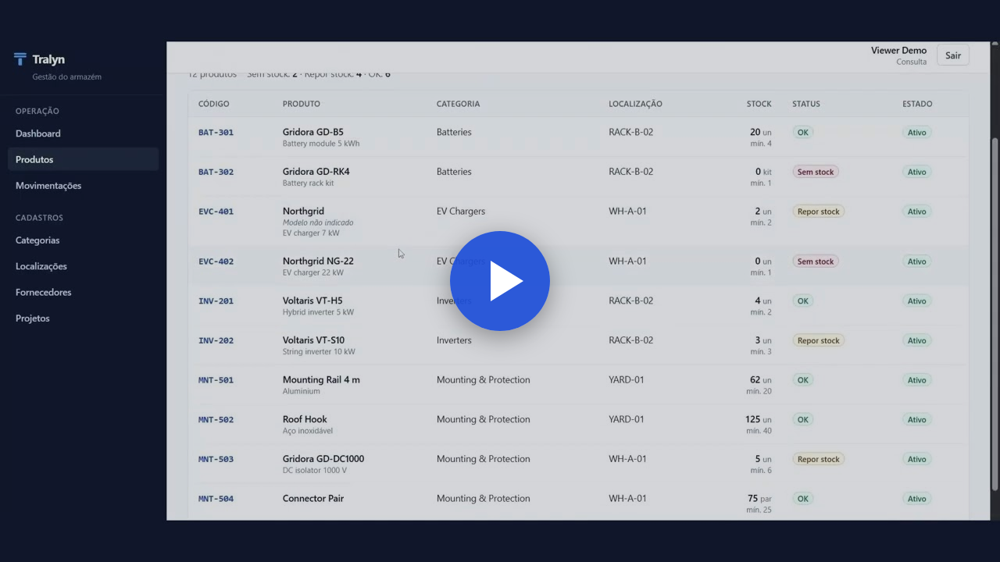
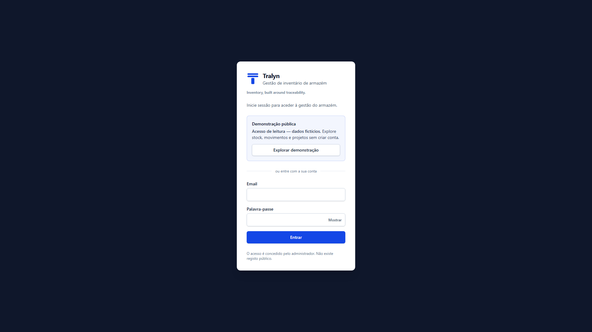
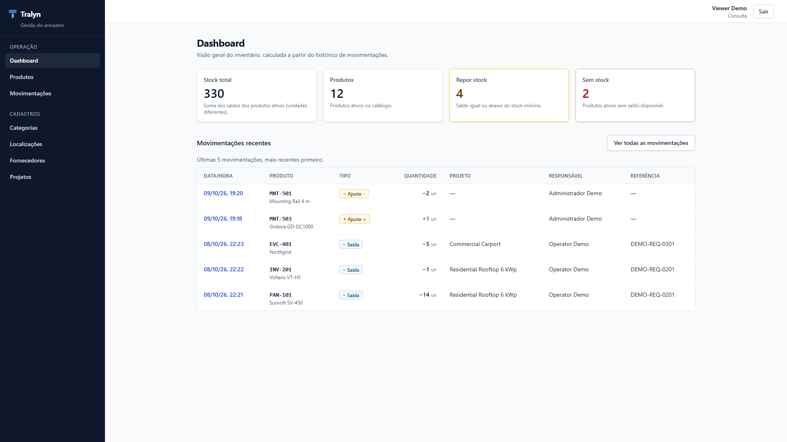
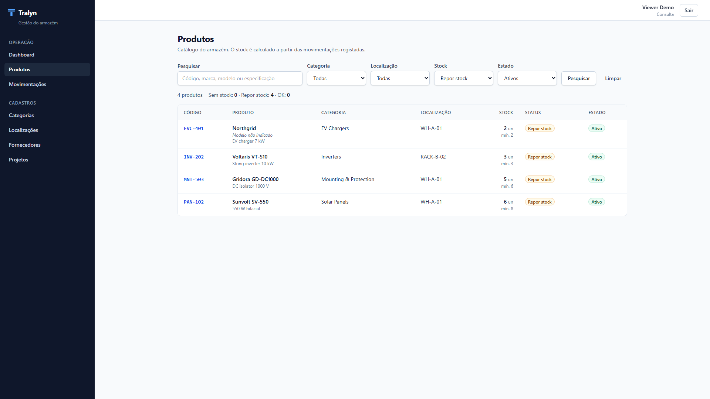
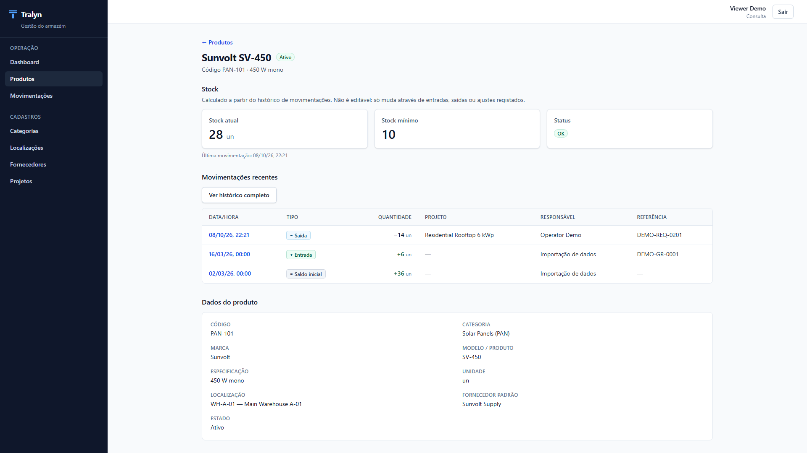
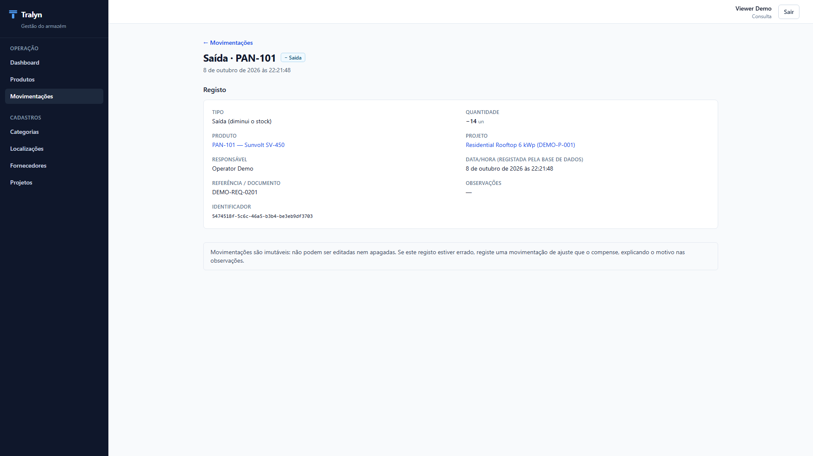
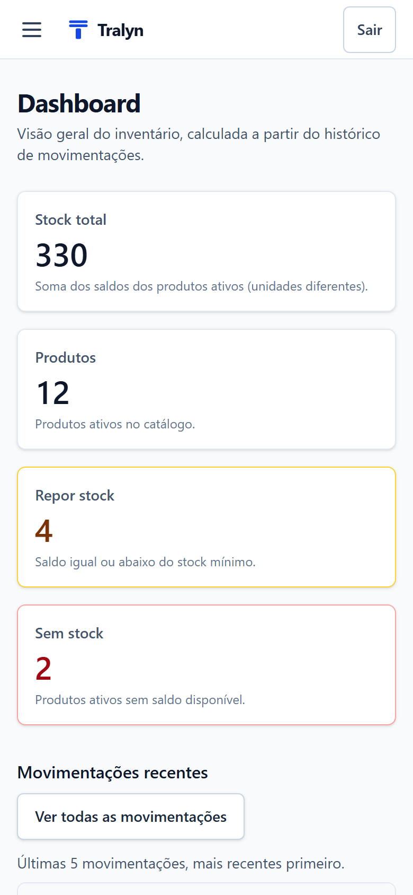
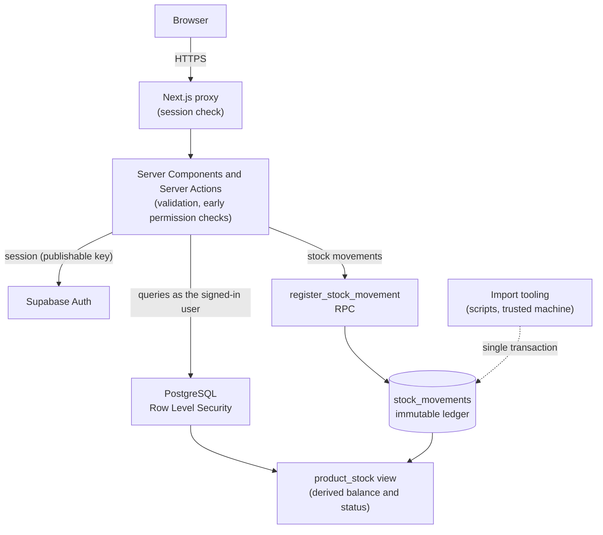
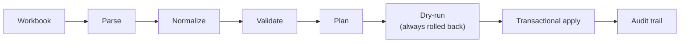

# Tralyn

**Warehouse inventory management, built around traceability.**

Stock is never edited directly: every balance is derived from an immutable, attributed movement ledger, and PostgreSQL enforces who may change it.

**[Live demo](https://tralyn.vercel.app)** · [Watch demo video](https://youtu.be/4XeDwiE5B28) · [Portfolio](https://brotherson.dev/) · [Source](https://github.com/brotherson10/tralyn)


> Independent portfolio project · all data is fictional · the user interface is in European Portuguese.

## Video Demo

[](https://youtu.be/4XeDwiE5B28)

A short walkthrough of the public read-only demo. [Watch on YouTube](https://youtu.be/4XeDwiE5B28).

## Screenshots

Real captures of the public demo, signed in as the read-only viewer.

| | |
| --- | --- |
|  |  |
| **Sign-in** with read-only public demo access | **Dashboard** calculated from the movement history |
|  |  |
| **Products** filtered by stock status | **Product detail**: balance explained by its movements |
|  |  |
| **Movement detail**: who, what, when and why | **Mobile** layout (390 × 844) |

## Contents

1. [Overview](#overview)
2. [Key Features](#key-features)
3. [Architecture and Technical Decisions](#architecture-and-technical-decisions)
4. [Stock Ledger Model](#stock-ledger-model)
5. [Security and Access Control](#security-and-access-control)
6. [Legacy Data Migration](#legacy-data-migration)
7. [Testing and Quality](#testing-and-quality)
8. [Tech Stack](#tech-stack)
9. [Demo Access](#demo-access)
10. [Getting Started](#getting-started)
11. [Project Structure](#project-structure)
12. [Project Context and Disclaimer](#project-context-and-disclaimer)
13. [Roadmap](#roadmap)
14. [License](#license)

## Overview

Spreadsheet-based warehouse processes work at first, but they make some things hard:

- **tracing why stock changed**, and who changed it;
- **separating stock state from stock history**, when a cell can simply be overwritten;
- **enforcing operational permissions**, such as who may only read, move stock in and out, or correct it;
- **migrating legacy data safely**, without losing or duplicating information;
- **preventing invalid states**, such as negative stock or silent corrections.

Tralyn explores how these problems can be solved through application and database design, rather than through conventions people have to remember. It manages a warehouse catalogue (products, categories, locations, suppliers and projects) and the stock movements that change it. The database is the single source of truth: PostgreSQL derives every balance and stock status, enforces the permissions of each role, and keeps the movement history immutable.

The user interface is in European Portuguese. The code and the documentation are in English.

## Key Features

- **Product catalogue:** search and filters (category, location, stock status, active state), product detail with stock cards and movement history, create, edit and deactivate.
- **Master data:** categories (unique name and code prefix), locations, suppliers and projects (active, completed or cancelled).
- **Stock status:** OK, *Repor stock* (reorder) and *Sem stock* (out of stock), computed by the database from the balance and the minimum stock.
- **Immutable movement history:** a paginated history with filters (type, project, date range, product) and a read-only movement detail.
- **Stock movements:** entries (`IN`) and exits (`OUT`), optionally linked to an active project and a document reference, plus administrator adjustments (`ADJUSTMENT_IN` and `ADJUSTMENT_OUT`) that always require a reason, with a balance preview.
- **Calculated balances:** there is no editable stock field; balances come from the ledger.
- **Role-based permissions:** administrator, operator and read-only viewer, enforced in PostgreSQL.
- **Operational dashboard:** total stock, active products, reorder and out-of-stock counts, and the latest movements.
- **Responsive interface:** an accessible mobile navigation drawer, collapsible filters and tables that scroll inside their container.
- **Legacy workbook import:** a fail-closed, deterministic and idempotent pipeline with a transactional dry-run and an audit trail.
- **Public read-only demo:** one click fills in a shared viewer account whose credentials cannot be changed.
- **Local demo environment:** one command builds the same fictional scenario on the local Supabase stack.

## Architecture and Technical Decisions



- **Browser:** renders the UI and holds only the user's session cookies.
- **Next.js server layer:** the proxy requires a session on every route; Server Components and Server Actions validate input (Zod) and check permissions early, for clear feedback.
- **Supabase Auth:** email and password sign-in, with no public sign-up. Every user has a profile with a role and an active flag.
- **PostgreSQL:** Row Level Security on every table, a movement RPC as the only operational write path to the ledger, constraints and triggers for integrity, and the `product_stock` view that derives balances.
- **Import tooling:** command-line scripts in `scripts/` that are not part of the web application. They run from a trusted machine and write the ledger in one audited transaction.

Key decisions:

- **Derived stock, not stored stock.** `product_stock` is a view over `stock_movements`; there is no editable quantity column to drift out of sync.
- **A single operational write path.** Movements go through one `SECURITY DEFINER` RPC that checks the role per movement type, the product, the project and the adjustment reason, and locks the product row (`FOR UPDATE`) so concurrent exits are serialized.
- **The database is the authority.** The UI only hides what a role cannot do; Row Level Security, the RPC, constraints and triggers are what actually refuse it.
- **No privileged credentials in the web app.** It talks to Supabase only as the signed-in user, with the publishable key. It is deployed on Vercel with a hosted Supabase project, and needs nothing but the public URL and key.
- **Auditable migration.** Legacy data enters through a fail-closed, idempotent import with an always-rolled-back dry-run and append-only audit tables.

## Stock Ledger Model

Products describe items; they do not store stock. The `stock_movements` table is an append-only ledger, and the `product_stock` view derives the current balance and status of every product.

| Movement type | Effect | Who creates it |
| --- | --- | --- |
| `OPENING_BALANCE` | adds | the technical import only |
| `IN` | adds | administrator, operator |
| `OUT` | subtracts | administrator, operator |
| `ADJUSTMENT_IN` | adds | administrator |
| `ADJUSTMENT_OUT` | subtracts | administrator |

| Rule | Enforcement |
| --- | --- |
| Quantities are always positive; the type defines the direction | `CHECK (quantity > 0)` and RPC validation |
| History is immutable | triggers reject `UPDATE`, `DELETE` and `TRUNCATE` for every role |
| Stock never goes negative | a `BEFORE INSERT` trigger checks the balance |
| Concurrent exits are safe | the product row is locked (`FOR UPDATE`), so outputs on the same product are serialized |
| Who and when cannot be forged | the user comes from the session and the timestamp from the database clock |
| Adjustments must be justified | the RPC rejects `ADJUSTMENT_IN` / `ADJUSTMENT_OUT` without notes (`ADJUSTMENT_NOTES_REQUIRED`), not only the form |
| Mistakes are corrected, not erased | a wrong movement is compensated by an adjustment; the original stays in the history |

`OPENING_BALANCE` is restricted to the technical import path: the operational RPC rejects it for every role, and a product can have at most one.

Why a ledger:

- **Auditability:** every unit can be traced to a dated, attributed movement.
- **Traceability:** a product's balance is explained by its history.
- **Consistent calculations:** the dashboard, lists and details all read the same derived view.
- **A safer concurrency model:** the database serializes conflicting exits, instead of application code racing on a stored number.

## Security and Access Control

| Role | Read | `IN` / `OUT` | `ADJUSTMENT_IN` / `ADJUSTMENT_OUT` | Products and master data |
| --- | :---: | :---: | :---: | :---: |
| `admin` | ✓ | ✓ | ✓ | ✓ |
| `operator` | ✓ | ✓ | — | — |
| `viewer` | ✓ | — | — | — |

UI visibility is a convenience, not the authority. Permissions are layered, and **PostgreSQL is the decisive boundary**:

1. **Proxy:** every route requires a valid session, except sign-in, the forced sign-out endpoint and the health check.
2. **Data access layer:** pages and Server Actions refuse inactive or missing profiles.
3. **UI and Server Actions:** only permitted actions are offered, and actions re-check the permission before touching data.
4. **Row Level Security:** reads require an active profile; writes to products and master data require an administrator.
5. **Movement RPC:** checks the role per movement type, the product, the project and the adjustment reason.
6. **Constraints and triggers:** immutability, non-negative stock, one opening balance per product, and protection against removing the last active administrator.

A test checks that the UI permission map matches what the database actually allows, for every role and movement type. Records are deactivated, never physically deleted, and business records are protected by `ON DELETE RESTRICT` foreign keys.

**Shared demo account.** The public demo signs in as a read-only viewer whose credentials are intentionally public. Any signed-in user can call the Auth API for their own account, so a `BEFORE UPDATE` trigger on `auth.users` rejects every change to the password, e-mail or phone of the accounts listed in `private.locked_auth_users`, whatever the caller (Auth API, Admin API or SQL). Sign-in, session refresh and sign-out keep working. The lock table is not reachable by any API role, including `service_role`; unlocking is a deliberate SQL operation by the database owner.

See [SECURITY.md](SECURITY.md) to report a vulnerability.

## Legacy Data Migration

Existing data enters the ledger through a dedicated, offline-first pipeline:



- **Fail-closed validation:** the file is identified by name and SHA-256, exact headers and cell types are required, and any unexpected value stops the process.
- **Reconciliation:** the plan is checked against the workbook's own computed totals before any database is touched.
- **Deterministic source references:** the same file always produces the same plan.
- **Idempotency:** a re-run records items as *already present* instead of duplicating them.
- **Dry-run:** the complete import runs inside a transaction that is always rolled back.
- **Apply:** one transaction with an advisory lock, a baseline check and exact invariants verified before the commit.
- **Audit:** `import_batches` and `import_records` are append-only. Imported movements are attributed to a technical identity that cannot sign in.
- **Opening balances** are created only here, never through the operational flow.

The canonical workbook in the repository, [`fixtures/tralyn-demo.xlsx`](fixtures/tralyn-demo.xlsx), is entirely fictional. It reproduces the spreadsheet format the pipeline was built for (sheets, headers, formula columns, date serials and edge cases), so the pipeline can be tested without any private operational data. It is generated reproducibly by `npm run inventory:demo-workbook`.

## Testing and Quality

785 automated tests across four suites:

| Suite | Tests | Verifies |
| --- | ---: | --- |
| Unit (Vitest) | 457 | validation, permissions, ledger rules, dashboard KPIs, Server Actions, the import pipeline and canonical workbook, the demo guard and public demo configuration |
| Database / integration (Vitest + local Supabase) | 257 | RLS per role, the movement RPC (including adjustment notes), immutability, concurrency, locked shared accounts through the real Auth API, master data, the import audit, importer dry-run and apply |
| End-to-end (Playwright) | 68 | authentication, public demo access, products, movements, master data, filters, mobile navigation, responsive layouts at 375, 768 and 1280 px |
| Demo environment | 3 | repeatable setup, demo roles enforced by the database, refusal of non-local targets |

Type checking, ESLint, the production build and `supabase db lint` complete the verification. Six of the end-to-end tests cover the public demo block and run in a dedicated mode (`E2E_PUBLIC_DEMO=1`), with fictitious credentials on the local stack.

## Tech Stack

| Layer | Technology |
| --- | --- |
| Frontend | React 19, Next.js 16 (App Router, Server Components, Server Actions) |
| Language | TypeScript |
| Styling | Tailwind CSS 4 |
| Database | PostgreSQL on Supabase: Row Level Security, RPC, triggers, views |
| Auth | Supabase Auth with `@supabase/ssr` |
| Validation | Zod |
| Testing | Vitest, Playwright |
| Tooling | Supabase CLI, tsx, SheetJS (workbook parsing), node-postgres |
| Deployment | Vercel and hosted Supabase |

## Demo Access

**Public demo (read-only).** Open [tralyn.vercel.app](https://tralyn.vercel.app) and choose **Explorar demonstração**: the sign-in form is filled in for a shared viewer account, and **Entrar** opens the application. You can browse the dashboard, products, movements, projects and the other catalogues; nothing can be created or changed, and all data is fictional. The account's credentials are locked, so they cannot be changed by visitors.

**Local demo.** The same scenario can be built on your own machine:

```bash
npm run demo:setup
```

> [!WARNING]
> **Local only, and destructive for the local database.** The command resets the local Supabase database and rebuilds the demo from scratch. It refuses to run unless every signal (project, API and database URLs, environment) points at the local stack, and it accepts no options.

The command:

1. resets the local database (migrations and the structural seed);
2. provisions the technical import identity and three fictional demo users;
3. imports the canonical demo workbook through the migration pipeline;
4. creates suppliers and projects through the application's services;
5. registers operational movements through the movement RPC, as the demo users;
6. verifies the final state against pinned invariants.

The result is 5 categories, 3 locations, 2 suppliers, 3 projects, 12 products and 21 movements, ending at 330 units with 6 OK, 4 reorder and 2 out-of-stock products. Running it again produces the same state.

**Local demo accounts.** The password is intentionally public and works only on your local stack; no hosted account uses it. On the public demo, use **Explorar demonstração** instead.

| Role | Email | Password |
| --- | --- | --- |
| Administrator | `admin.demo@tralyn.test` | `tralyn-demo-2026` |
| Operator | `operator.demo@tralyn.test` | `tralyn-demo-2026` |
| Viewer | `viewer.demo@tralyn.test` | `tralyn-demo-2026` |

## Getting Started

**Requirements:** Node.js 20.9 or newer, and Docker (for the local Supabase stack). The Supabase CLI is installed as a dev dependency.

```bash
git clone https://github.com/brotherson10/tralyn.git
cd tralyn
npm ci

# Start the local Supabase stack (applies the migrations and the seed).
npm run db:start

# Configure the app: copy the example, then fill in the publishable key
# printed by `npm run db:status`.
cp .env.example .env.local

# Optional, recommended: load the fictional demo (resets the local database).
npm run demo:setup

npm run dev
```

The app runs at `http://localhost:3000`. Public sign-up is disabled; with the demo loaded, sign in with one of the [local demo accounts](#demo-access).

**Verification:**

```bash
npm run typecheck
npm run lint
npm test                            # unit tests
npm run db:reset && npm run test:db # database tests (they need a database without the demo)
npx playwright install chromium     # once, for the end-to-end tests
npm run test:e2e                    # builds the app and runs it against the local stack
E2E_PUBLIC_DEMO=1 npx playwright test tests/e2e/public-demo.spec.ts  # public demo block
npm run test:demo                   # demo environment tests (reset the local database)
npm run build
npm run db:lint
```

`npm run db:reset` recreates the local database from the migrations and the seed. Environment variables, including the optional public demo variables, are documented in [`.env.example`](.env.example).

## Project Structure

```text
src/app               Routes: sign-in, protected pages, health check
src/components        UI components (layout, brand, forms, tables, dashboard)
src/lib               Auth, Supabase clients, stock rules, demo configuration, shared helpers
src/services          Data access layer (always as the signed-in user)
src/validation        Zod schemas for forms and filters
supabase/migrations   Schema, RLS policies, the movement RPC, triggers and the account lock
supabase/seed.sql     Structural seed (the demo categories)
scripts/              Command-line tooling: import pipeline, technical identity, demo setup
tests/db              Database and authorization integration tests
tests/e2e             Playwright end-to-end and responsive tests
tests/demo            Demo environment tests
fixtures/             The fictional canonical workbook
docs/screenshots      Screenshots of the public demo
```

## Project Context and Disclaimer

Tralyn is an independent portfolio project by Brotherson Américo. It was inspired by warehouse workflows observed in the sustainable-energy sector, but it is not affiliated with, used by or endorsed by any company. All products, suppliers, projects, people and movements, in the repository and in the public demo, are fictional.

Please do not run automated scanners, load tests or denial-of-service attempts against the public demo (see [SECURITY.md](SECURITY.md)).

## Roadmap

Future work, not implemented:

- QR code and barcode scanning
- reporting and richer analytics
- user administration inside the application
- password recovery

## License

[MIT](LICENSE) © 2026 Brotherson Américo

**Author:** Brotherson Américo · [Portfolio](https://brotherson.dev/) · [GitHub](https://github.com/brotherson10) · [LinkedIn](https://www.linkedin.com/in/brotherson/)
