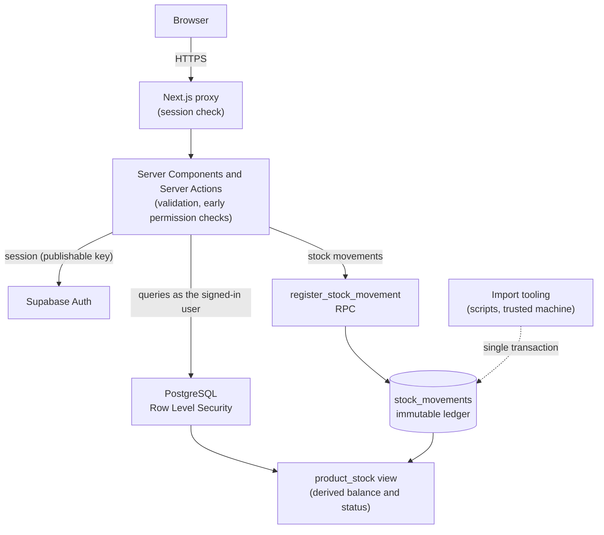
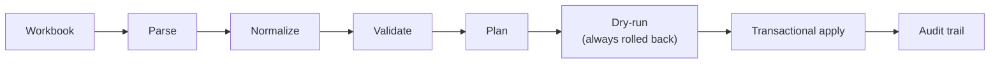

# Tralyn

**Warehouse Inventory Management**

*Inventory, built around traceability.*


Tralyn is an independent full-stack warehouse inventory management project, inspired by a real warehouse workflow I observed in the sustainable-energy sector. It is a portfolio engineering case with a production-style architecture: authentication, role-based permissions, an auditable data migration and 700+ automated tests.

Its central engineering rule:

> **Stock is never edited directly.**

Every stock change is an immutable movement entry, and current balances are derived from that ledger: every stock level has a history. The name reflects this idea, trace and lineage.

## Contents

1. [Overview](#overview)
2. [Why Tralyn](#why-tralyn)
3. [Core Features](#core-features)
4. [Architecture](#architecture)
5. [Stock Ledger Model](#stock-ledger-model)
6. [Authorization & Security](#authorization--security)
7. [Legacy Data Migration](#legacy-data-migration)
8. [Demo Environment](#demo-environment)
9. [Testing](#testing)
10. [Tech Stack](#tech-stack)
11. [Running Locally](#running-locally)
12. [Project Structure](#project-structure)
13. [Roadmap](#roadmap)
14. [License](#license)

## Overview

Tralyn manages a warehouse catalogue (products, categories, locations, suppliers and projects) and the stock movements that change it. The database is the single source of truth: PostgreSQL derives every balance and stock status, enforces the permissions of each role, and keeps the movement history immutable.

The user interface is in European Portuguese. The code and the documentation are in English.

<!-- Screenshots will be added once the public demo deployment is available. -->

## Why Tralyn

Spreadsheet-based warehouse processes work at first, but they make some things hard:

- **tracing why stock changed**, and who changed it;
- **separating stock state from stock history**, when a cell can simply be overwritten;
- **enforcing operational permissions**, such as who may only read, move stock in and out, or correct it;
- **migrating legacy data safely**, without losing or duplicating information;
- **preventing invalid states**, such as negative stock or silent corrections.

Tralyn explores how these problems can be solved through application and database design, rather than through conventions people have to remember.

## Core Features

- **Product catalogue:** search and filters (category, location, stock status, active state), product detail with stock cards and movement history, create, edit and deactivate.
- **Master data:** categories (unique name and code prefix), locations, suppliers and projects (active, completed or cancelled).
- **Stock status:** OK, *Repor stock* (reorder) and *Sem stock* (out of stock), computed by the database from the balance and the minimum stock.
- **Immutable movement history:** a paginated history with filters (type, project, date range, product) and a read-only movement detail.
- **Stock movements:** entries (`IN`) and exits (`OUT`), optionally linked to an active project, plus administrator adjustments (`ADJUSTMENT_IN` and `ADJUSTMENT_OUT`), with a balance preview.
- **Calculated balances:** there is no editable stock field; balances come from the ledger.
- **Role-based permissions:** administrator, operator and read-only viewer, enforced in PostgreSQL.
- **Operational dashboard:** total stock, active products, reorder and out-of-stock counts, and the latest movements.
- **Responsive interface:** an accessible mobile navigation drawer, collapsible filters and tables that scroll inside their container.
- **Legacy workbook import:** a fail-closed, deterministic and idempotent pipeline with a transactional dry-run and an audit trail.
- **Local demo environment:** one command builds a complete, fictional demo on the local Supabase stack.

## Architecture



- **Browser:** renders the UI and holds only the user's session cookies.
- **Next.js server layer:** the proxy requires a session on every route; Server Components and Server Actions validate input (Zod) and check permissions early, for clear feedback.
- **Supabase Auth:** email and password sign-in, with no public sign-up. Every user has a profile with a role and an active flag.
- **PostgreSQL:** Row Level Security on every table, a movement RPC as the only operational write path to the ledger, constraints and triggers for integrity, and the `product_stock` view that derives balances.
- **Import tooling:** command-line scripts in `scripts/` that are not part of the web application. They run from a trusted machine and write the ledger in one audited transaction.

The web application always talks to the database as the signed-in user, with the public (publishable) key. It holds no privileged credentials. It is designed to be deployed on Vercel with a hosted Supabase project.

## Stock Ledger Model

Products describe items; they do not store stock. The `stock_movements` table is an append-only ledger, and the `product_stock` view derives the current balance and status of every product.

| Movement type | Effect | Who creates it |
| --- | --- | --- |
| `OPENING_BALANCE` | adds | the technical import only |
| `IN` | adds | administrator, operator |
| `OUT` | subtracts | administrator, operator |
| `ADJUSTMENT_IN` | adds | administrator |
| `ADJUSTMENT_OUT` | subtracts | administrator |

| Rule | Enforcement |
| --- | --- |
| Quantities are always positive; the type defines the direction | `CHECK (quantity > 0)` and RPC validation |
| History is immutable | triggers reject `UPDATE`, `DELETE` and `TRUNCATE` for every role |
| Stock never goes negative | a `BEFORE INSERT` trigger checks the balance |
| Concurrent exits are safe | the product row is locked (`FOR UPDATE`), so outputs on the same product are serialized |
| Who and when cannot be forged | the user comes from the session and the timestamp from the database clock |
| Mistakes are corrected, not erased | a wrong movement is compensated by an adjustment; the original stays in the history |

`OPENING_BALANCE` is restricted to the technical import path: the operational RPC rejects it for every role, and a product can have at most one.

Why a ledger:

- **Auditability:** every unit can be traced to a dated, attributed movement.
- **Traceability:** a product's balance is explained by its history.
- **Consistent calculations:** the dashboard, lists and details all read the same derived view.
- **A safer concurrency model:** the database serializes conflicting exits, instead of application code racing on a stored number.

## Authorization & Security

| Role | Read | `IN` / `OUT` | `ADJUSTMENT_IN` / `ADJUSTMENT_OUT` | Products and master data |
| --- | :---: | :---: | :---: | :---: |
| `admin` | ✓ | ✓ | ✓ | ✓ |
| `operator` | ✓ | ✓ | — | — |
| `viewer` | ✓ | — | — | — |

UI visibility is a convenience, not the authority. Permissions are layered, and **PostgreSQL is the decisive boundary**:

1. **Proxy:** every route requires a valid session, except sign-in, the forced sign-out endpoint and the health check.
2. **Data access layer:** pages and Server Actions refuse inactive or missing profiles.
3. **UI and Server Actions:** only permitted actions are offered, and actions re-check the permission before touching data.
4. **Row Level Security:** reads require an active profile; writes to products and master data require an administrator.
5. **Movement RPC:** checks the role per movement type, the product and the project.
6. **Constraints and triggers:** immutability, non-negative stock, one opening balance per product, and protection against removing the last active administrator.

A test checks that the UI permission map matches what the database actually allows, for every role and movement type. Records are deactivated, never physically deleted, and business records are protected by `ON DELETE RESTRICT` foreign keys.

See [SECURITY.md](SECURITY.md) to report a vulnerability.

## Legacy Data Migration

Existing data enters the ledger through a dedicated, offline-first pipeline:



- **Fail-closed validation:** the file is identified by name and SHA-256, exact headers and cell types are required, and any unexpected value stops the process.
- **Reconciliation:** the plan is checked against the workbook's own computed totals before any database is touched.
- **Deterministic source references:** the same file always produces the same plan.
- **Idempotency:** a re-run records items as *already present* instead of duplicating them.
- **Dry-run:** the complete import runs inside a transaction that is always rolled back.
- **Apply:** one transaction with an advisory lock, a baseline check and exact invariants verified before the commit.
- **Audit:** `import_batches` and `import_records` are append-only. Imported movements are attributed to a technical identity that cannot sign in.
- **Opening balances** are created only here, never through the operational flow.

The canonical workbook in the repository, [`fixtures/tralyn-demo.xlsx`](fixtures/tralyn-demo.xlsx), is entirely fictional. It reproduces the spreadsheet format the pipeline was built for (sheets, headers, formula columns, date serials and edge cases), so the pipeline can be tested without any private operational data. It is generated reproducibly by `npm run inventory:demo-workbook`.

## Demo Environment

```bash
npm run demo:setup
```

> [!WARNING]
> **Local only, and destructive for the local database.** The command resets the local Supabase database and rebuilds the demo from scratch. It refuses to run unless every signal (project, API and database URLs, environment) points at the local stack, and it accepts no options.

The command:

1. resets the local database (migrations and the structural seed);
2. provisions the technical import identity and three fictional demo users;
3. imports the canonical demo workbook through the migration pipeline;
4. creates suppliers and projects through the application's services;
5. registers operational movements through the movement RPC, as the demo users;
6. verifies the final state against pinned invariants.

The result is 5 categories, 3 locations, 2 suppliers, 3 projects, 12 products and 21 movements, ending at 330 units with 6 OK, 4 reorder and 2 out-of-stock products. Running it again produces the same state.

**Local demo accounts.** The password is intentionally public and works only on your local stack. These are not hosted credentials.

| Role | Email | Password |
| --- | --- | --- |
| Administrator | `admin.demo@tralyn.test` | `tralyn-demo-2026` |
| Operator | `operator.demo@tralyn.test` | `tralyn-demo-2026` |
| Viewer | `viewer.demo@tralyn.test` | `tralyn-demo-2026` |

## Testing

748 automated tests across four suites:

| Suite | Tests | Verifies |
| --- | ---: | --- |
| Unit (Vitest) | 447 | validation, permissions, ledger rules, dashboard KPIs, Server Actions, the import pipeline and canonical workbook, the demo guard |
| Database / integration (Vitest + local Supabase) | 237 | RLS per role, the movement RPC, immutability, concurrency, master data, the import audit, importer dry-run and apply |
| End-to-end (Playwright) | 61 | authentication, products, movements, master data, filters, mobile navigation, responsive layouts at 375, 768 and 1280 px |
| Demo environment | 3 | repeatable setup, demo roles enforced by the database, refusal of non-local targets |

Type checking, ESLint, the production build and `supabase db lint` complete the verification.

## Tech Stack

| Layer | Technology |
| --- | --- |
| Frontend | React 19, Next.js 16 (App Router, Server Components, Server Actions) |
| Language | TypeScript |
| Styling | Tailwind CSS 4 |
| Database | PostgreSQL on Supabase: Row Level Security, RPC, triggers, views |
| Auth | Supabase Auth with `@supabase/ssr` |
| Validation | Zod |
| Testing | Vitest, Playwright |
| Tooling | Supabase CLI, tsx, SheetJS (workbook parsing), node-postgres |
| Deployment target | Vercel and hosted Supabase |

## Running Locally

**Requirements:** Node.js 20.9 or newer, and Docker (for the local Supabase stack). The Supabase CLI is installed as a dev dependency.

```bash
git clone <repository-url> tralyn
cd tralyn
npm ci

# Start the local Supabase stack (applies the migrations and the seed).
npm run db:start

# Configure the app: copy the example, then fill in the publishable key
# printed by `npm run db:status`.
cp .env.example .env.local

# Optional, recommended: load the fictional demo (resets the local database).
npm run demo:setup

npm run dev
```

The app runs at `http://localhost:3000`. Public sign-up is disabled; with the demo loaded, sign in with one of the [local demo accounts](#demo-environment).

**Verification:**

```bash
npm run typecheck
npm run lint
npm test                            # unit tests
npm run db:reset && npm run test:db # database tests (they need a database without the demo)
npx playwright install chromium     # once, for the end-to-end tests
npm run test:e2e                    # builds the app and runs it against the local stack
npm run test:demo                   # demo environment tests (reset the local database)
npm run build
npm run db:lint
```

`npm run db:reset` recreates the local database from the migrations and the seed. Environment variables are documented in [`.env.example`](.env.example).

## Project Structure

```text
src/app               Routes: sign-in, protected pages, health check
src/components        UI components (layout, brand, forms, tables, dashboard)
src/lib               Auth, Supabase clients, stock rules, shared helpers
src/services          Data access layer (always as the signed-in user)
src/validation        Zod schemas for forms and filters
supabase/migrations   Schema, RLS policies, the movement RPC and triggers
supabase/seed.sql     Structural seed (the demo categories)
scripts/              Command-line tooling: import pipeline, technical identity, demo setup
tests/db              Database and authorization integration tests
tests/e2e             Playwright end-to-end and responsive tests
tests/demo            Demo environment tests
fixtures/             The fictional canonical workbook
```

## Roadmap

Future work, not implemented:

- QR code and barcode scanning
- reporting and richer analytics
- user administration inside the application
- password recovery

## License

[MIT](LICENSE) © 2026 Brotherson Américo

**Author:** Brotherson Américo · [Portfolio](https://brotherson.dev/) · [GitHub](https://github.com/brotherson10) · [LinkedIn](https://www.linkedin.com/in/brotherson/)
